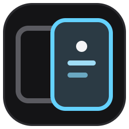
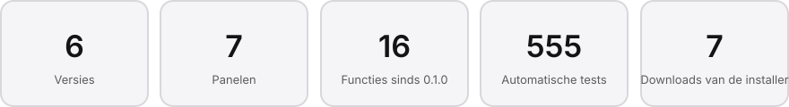
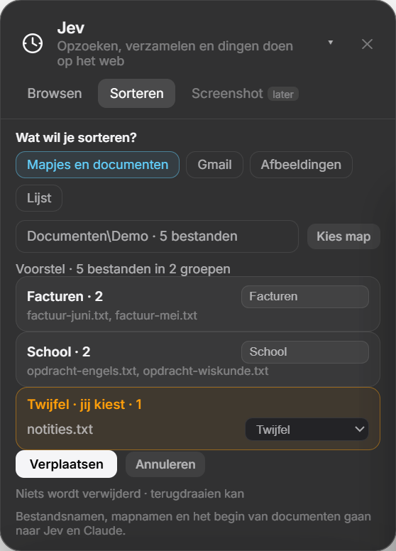
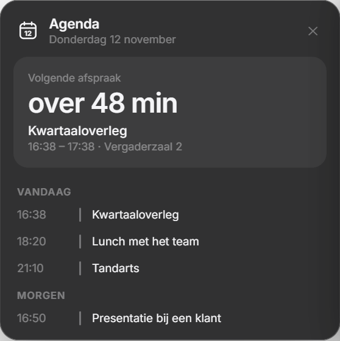
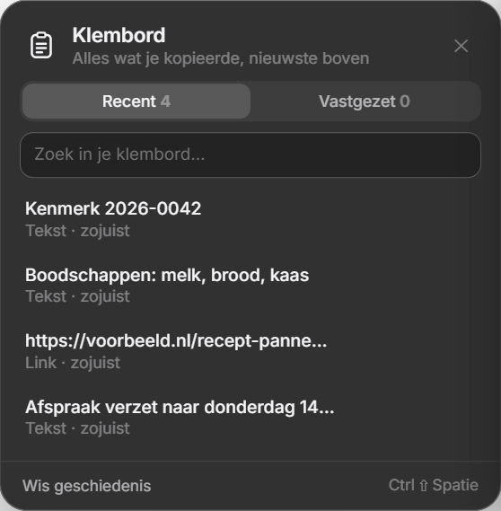

  

<h1 align="center">The Overlay</h1>

Je mail, je agenda, Claude en Jev in één strook aan de rand van je scherm. Beweeg ernaar en hij schuift open.

  

  
  

  <a href="https://github.com/Robotninja100/the-overlay-releases/releases/download/v0.1.8/The-Overlay-Setup-0.1.8.exe"><b>Download voor Windows</b></a> (versie 0.1.8) · <a href="https://github.com/Robotninja100/the-overlay-releases/releases/latest">Alle versies</a>

## In cijfers

<picture>
  <source media="(prefers-color-scheme: dark)" srcset="readme/stats-dark.svg">
  
</picture>

## Groei sinds 0.1.0

<picture>
  <source media="(prefers-color-scheme: dark)" srcset="readme/growth-dark.svg">
  
</picture>

**0.1.8** · 13 november 2026
- Claude-paneel: na klaar een vervolg sturen vanuit het paneel (app, VS Code en terminal)
- Claude-paneel: het gesprek van een sessie lezen als chat
- Claude-paneel: de agents van een sessie als kaarten naast het paneel

**0.1.7** · 13 november 2026
- Jev Screenshot: typ waarvan je een screenshot wilt, Jev zoekt de pagina en zet het stuk in beeld

**0.1.6** · 12 november 2026
- Jev Sorteren: Gmail, lijsten en afbeeldingen

Eerdere versies

**0.1.5** · 12 november 2026
- Een melding vóór elke afspraak, met de minuten zelf in te stellen
- Een nieuw app-icoon

**0.1.4** · 12 november 2026
- Jev Sorteren: mapjes en documenten, met terugdraaien

**0.1.2** · 12 november 2026
- Jev leest pagina's tegelijk en verzamelt sneller

**0.1.1** · 12 november 2026
- De app werkt zichzelf bij via het dashboard
- Codex-sessies in het Claude-paneel

**0.1.0** · 10 november 2026
- De strook aan de rand van je scherm, die opengaat als je ernaar beweegt
- Gmail: je inbox lezen en beantwoorden
- Claude Code: je sessies, hun vragen en meldingen
- Agenda: je komende afspraken
- Invulhulp: formulieren in je browser invullen vanuit je documenten
- Klembord: wat je kopieerde, om terug te plakken
- Dashboard: panelen aan en uit, met grafieken van je gebruik
- Jev Browsen: Jev zoekt op het web voor je
- Jev Verzamelen: lijsten van het web als tabel

## De panelen

- **Gmail**: je inbox in één blik: lezen en beantwoorden, en als je wilt schrijft Claude een concept.
- **Claude Code**: je Claude Code- en Codex-sessies op een rij. Je ziet wanneer er een klaar is of iets vraagt, en antwoordt meteen.
- **Agenda**: je volgende afspraak met aftelling, de rest van vandaag en morgen, en een melding vooraf.
- **Jev**: zoekt op het web, verzamelt lijsten als tabel, maakt een screenshot van precies het stuk dat je vraagt en sorteert je mapjes, mail, afbeeldingen en lijsten. Niets wordt verwijderd en terugdraaien kan.
- **Invulhulp**: vult formulieren in je browser in met de gegevens uit je eigen documenten.
- **Klembord**: alles wat je kopieerde, doorzoekbaar en vast te zetten.
- **Dashboard**: zet panelen aan en uit, laat je gebruik zien in grafieken en houdt de app bij.

  
  
  

## Wat heb je nodig

- **Windows** 10 of 11.
- **Gmail en Agenda**: je koppelt je eigen Google-account. Daarvoor maak je eenmalig een eigen Google-sleutel (OAuth-client) aan in Google Cloud, ongeveer 10 minuten werk. Zolang die sleutel in de testmodus staat, geef je elke 7 dagen opnieuw toestemming.
- **Claude Code** voor het Claude-paneel en voor alles waar Claude meedenkt: Jev Verzamelen en Sorteren, de mailhulp en de Invulhulp.
- **Jev** werkt met een eigen sleutel van TypeSafe. Die kost een klein bedrag per vraag.
- **Invulhulp** werkt via een browserextensie die niet in een winkel staat. Je laadt hem zelf in Chrome of Edge via de ontwikkelaarsmodus ("Uitgepakte extensie laden") en koppelt hem met een code.
- **Werkt meteen**, zonder iets te koppelen: het Klembord en het Dashboard.

## Installeren

1. Download de installer hierboven en open hem.
2. Waarschuwt Windows dat het je pc heeft beschermd? Klik op **Meer info** en daarna op **Toch uitvoeren**. De installer is nog niet ondertekend.
3. Daarna werkt The Overlay zichzelf bij: een nieuwe versie zie je in het dashboard.

---

Versie 0.1.8 · 13 november 2026
